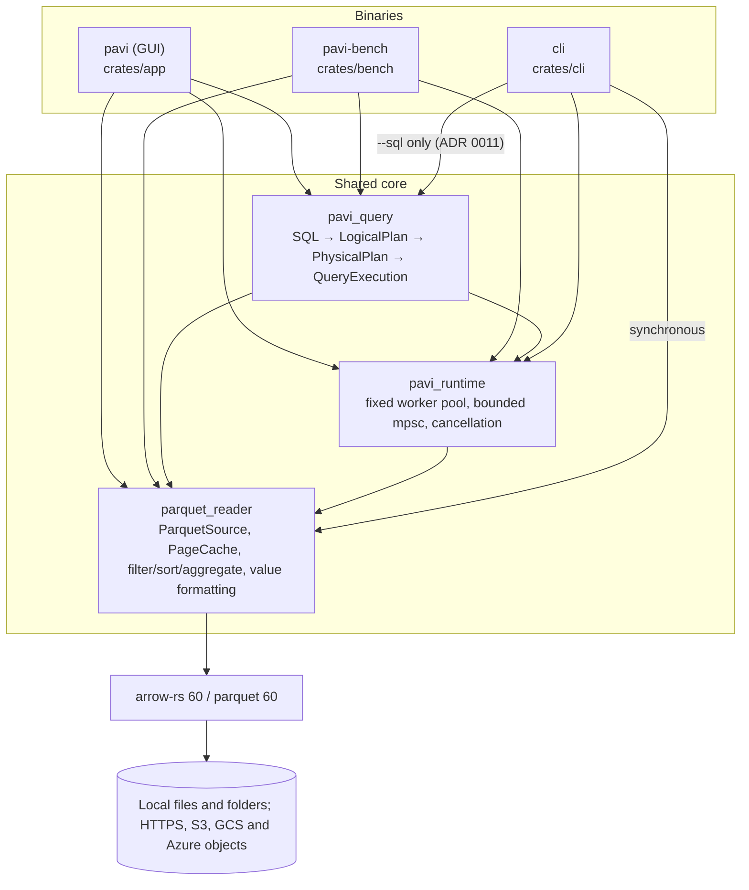

# PAVI Architecture

The short version: what PAVI is, how it is shaped, and the rules that keep it fast and safe.
Read this first; open a deep-dive below only when your task touches that area.

## TL;DR

- **What it is.** PAVI is a native Parquet explorer. The desktop app (`pavi`, egui/eframe) opens Parquet files, CSV, JSON and Arrow/Feather files (read into a temporary Parquet file, ADR 0007), remote files by `https`, `s3`, `gs` or `az` URL (blocking HTTP range requests, ADR 0008), or a folder of Parquet files (with `key=value` partitions) as one table, each in its own tab, shows each in a virtualized grid that loads 4,096-row pages on demand, and offers a filter of tests joined by `AND`/`OR`, a small SQL subset (`SELECT … FROM dataset [WHERE …] [ORDER BY up to 8 columns] [LIMIT n]`, plus `COUNT/SUM/AVG/MIN/MAX` with up to 8 `GROUP BY` columns; joins between open tabs and subqueries are prepared into a temporary table first, ADR 0009), sorting by several columns on files of any size (spilling to temporary files past the memory budget), find in loaded rows, charts, single-column profiling, an Inspector (schema, row-group statistics, file info), clipboard copy, and CSV, Parquet, JSON Lines and Arrow export. A separate `pavi-cli` binary (package `cli`) prints metadata, schema and the first ≤1,000 rows (optionally filtered) as a box-drawn table, counts rows, sorts, prints the schema and row-group statistics, runs the app's SQL subset over the file and other files (`--sql`, `--table`), reads standard input, and streams rows to standard output or a file as CSV, JSON Lines, Parquet or Arrow with the same writers as the app's export (`parquet_reader::export`).
- **Shape.** A layered Cargo workspace: `parquet_reader` (all Arrow/Parquet I/O, filter, sort, aggregate, cell formatting) → `pavi_runtime` (fixed std-thread worker pool with bounded channels) → `pavi_query` (SQL parser → logical plan → flattened physical plan → incremental execution) → `pavi` (GUI). The CLI reads through `parquet_reader` synchronously on its main thread; only `--sql` starts a `pavi_runtime` pool and runs the query with `pavi_query`, as the app does (ADR 0011).
- **Concurrency.** No async runtime. All file I/O runs on `pavi-page-N` worker threads (one per CPU). The UI thread submits tasks and **polls** `mpsc` receivers with `try_recv()` every frame, requesting a repaint every 16 ms while anything is pending. Stale results are discarded with a `GenerationId`. Export and profiling each get one extra short-lived thread that drives a query through the same pool.
- **Memory model.** Everything is "bounded": ≤8 UI pages + ≤8 cached source pages (128 MB), ≤8 result batches for filter/SQL/sort windows, sort ≤100,000 rows / 128 MB in memory (larger sorts spill to ≤32 GiB of temporary files, ADR 0005), group-by ≤10,000 groups / 8 MB, profile ≤4,096 distinct values, charts ≤16,384 input rows, clipboard ≤16 MB.
- **The main pattern** is one central `PaviApp` (`crates/app/src/app.rs`) that coordinates the app and delegates self-contained state to its own types: `SourcePages` (page reads and cache, `pages.rs`), `FilteredGrid` (result window, `results.rs`), `ChartState`, `ProfileState` and `ExportState`. The `ui/*.rs` files are `impl PaviApp` blocks that render *and* mutate state directly (no message/command enum).
- **Tooling.** GitHub Actions CI (`.github/workflows/ci.yml`) runs `cargo fmt --check`, `cargo clippy --all-targets --all-features -D warnings`, and `cargo test --workspace` on Windows and Ubuntu, using the Rust version pinned in `rust-toolchain.toml` (1.99.1). No logging/tracing and no `cfg(target_os)`. `unsafe`, `unwrap`, `expect` and `panic!` are denied in non-test code by `[workspace.lints]`.

## Invariants

These are the rules the design depends on. A change that breaks one needs an ADR in [`docs/decisions/`](decisions/) first.

1. **Dependencies point down.** `pavi` (app) → `pavi_query` → `pavi_runtime` → `parquet_reader`. The CLI uses `parquet_reader`, and `pavi_query` with `pavi_runtime` only for `--sql` (ADR 0011). No library depends on the GUI or the CLI, and there are no cycles.
2. **The UI thread never does file I/O or decoding.** All reads go through the runtime pool; the UI submits a task, keeps the receiver, and polls it with `try_recv()` once per frame. Known exceptions: native `rfd` dialogs and the small session JSON write.
3. **Every buffer is bounded.** Pages, result windows, sort input, groups, profile values, chart points, history, clipboard: each has a named constant cap and a clear error when it is exceeded. A sort past its memory cap spills to temporary files, which have their own cap (ADR 0005). New in-memory collections that grow with the file need the same.
4. **Every background result carries a `GenerationId`.** Each restart (open, filter, SQL, sort, clear) bumps the generation; consumers drop responses from older generations.
5. **Long work is cancellable.** Scans check their cancellation token and the runtime shutdown flag at least once per 4,096-row batch.
6. **Locks are short.** No lock is held across decoding, file I/O or rendering.
7. **One source of truth per rule.** Value → text lives only in `parquet_reader::value`; which Arrow types an operation accepts lives only in `parquet_reader::types`.
8. **Writes are atomic.** Export and session files are written to a temporary file next to the target, then renamed. Failure or cancel deletes the temporary file.
9. **No async runtime, no `unsafe`, no panics in non-test code.** Errors are `anyhow::Result` and reach the user through the status bar or an inline error.

## Deep dives

| Read this | When your task touches |
|---|---|
| [architecture/modules.md](architecture/modules.md) | Tech stack, crate responsibilities, module trees, `PaviApp` state, CLI arguments |
| [architecture/data-flows.md](architecture/data-flows.md) | Open, scroll/paging, filter, sort, SQL/aggregates, Inspector/profiling, export/clipboard, charts, CLI (with sequence diagrams) |
| [architecture/concurrency.md](architecture/concurrency.md) | The per-frame loop, worker pool, cancellation, shared state/locks, session persistence, dependency graph |
| [architecture/boundaries.md](architecture/boundaries.md) | File system, supported Parquet/Arrow types and features, large-file limits, platform-specific code |
| [DESIGN.md](DESIGN.md) | Anything visual: colors, spacing, sizes, widgets, UI states |
| [PERFORMANCE.md](PERFORMANCE.md) | Memory budgets, latency targets, how to benchmark |
| [TESTING.md](TESTING.md) | Where tests live and how to write them |
| [FUZZING.md](FUZZING.md) | Fuzz targets for files, filters and SQL; reproducing crashes |
| [../SECURITY.md](../SECURITY.md) | Untrusted input (files, SQL, paths) and what must never happen |
| [decisions/](decisions/) | Why things are the way they are |
