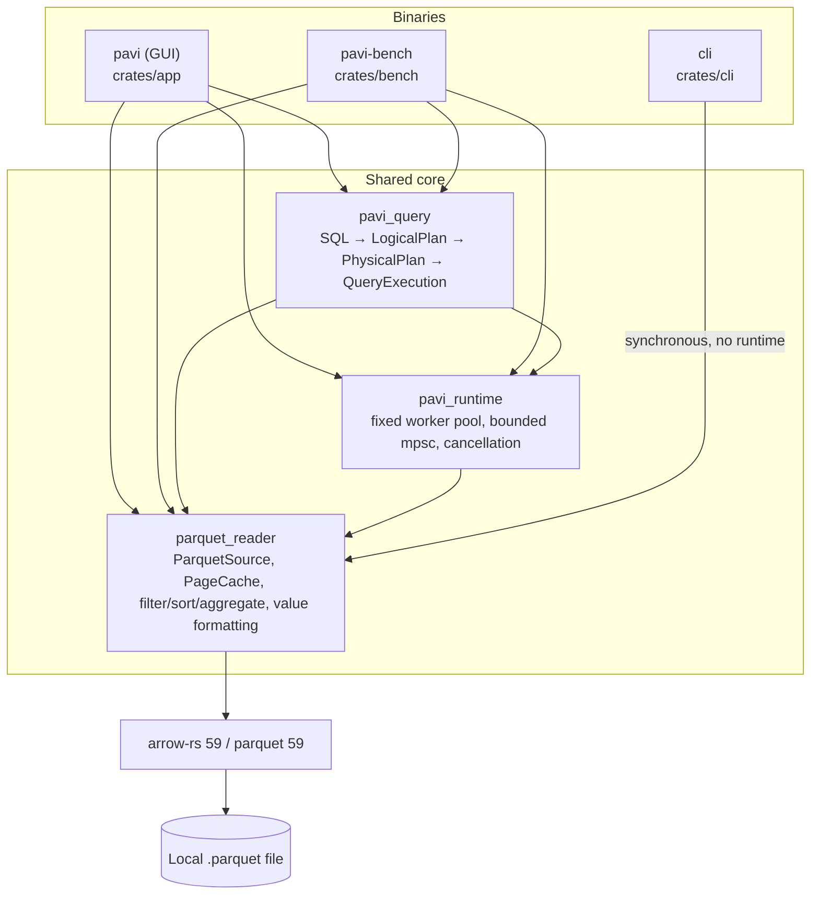
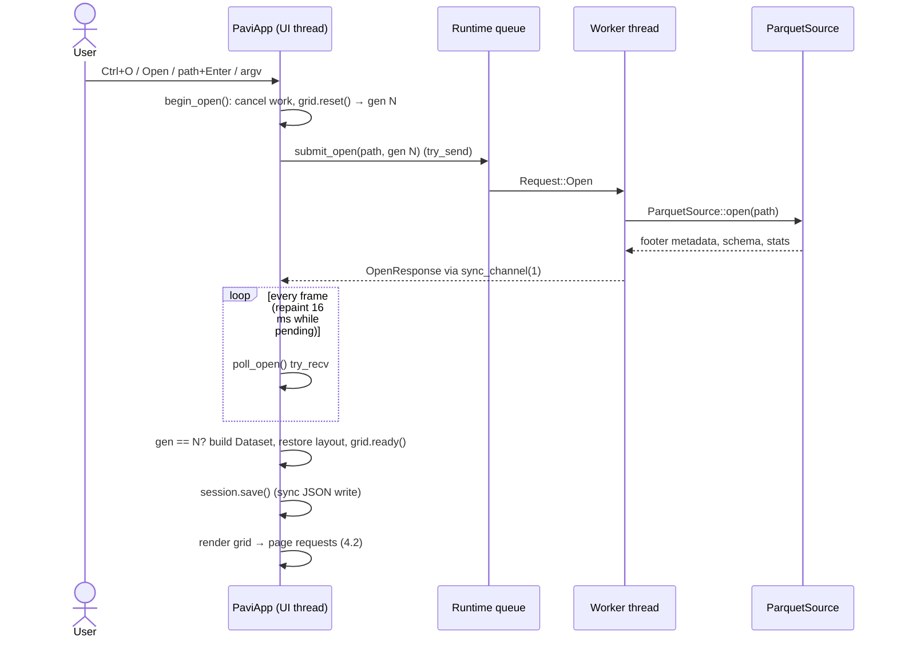
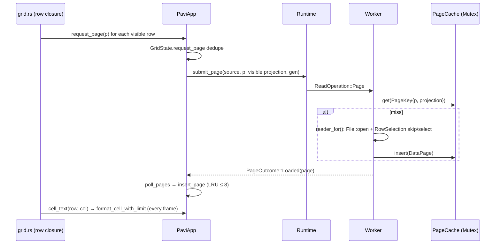
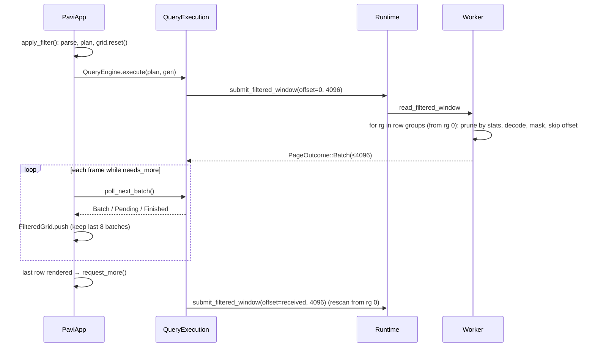
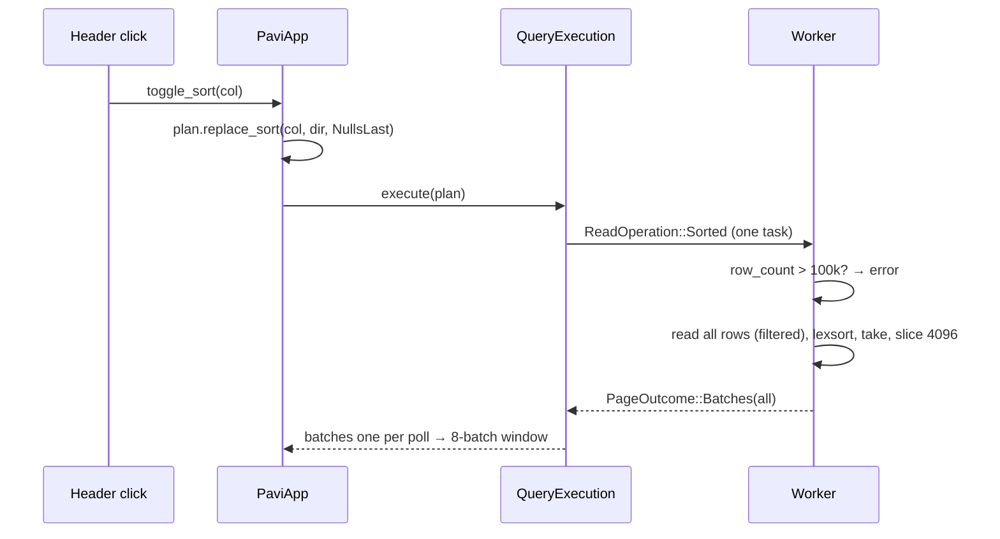
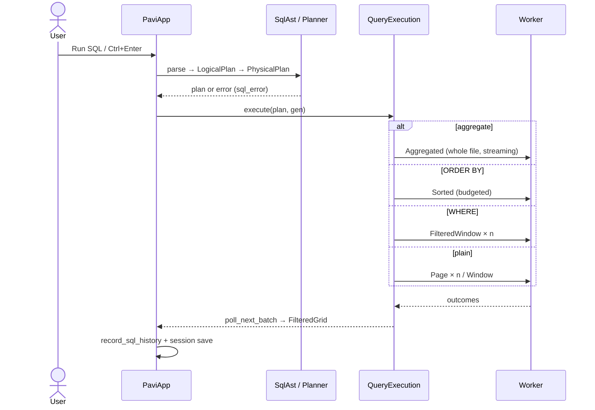
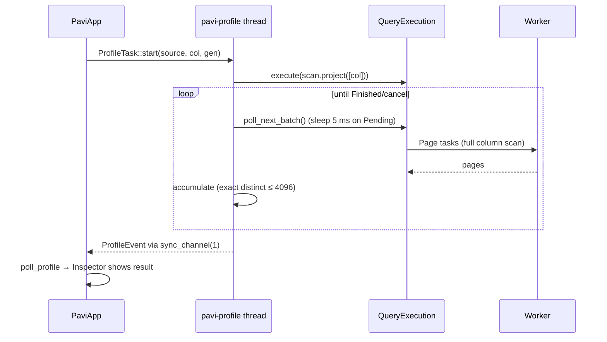
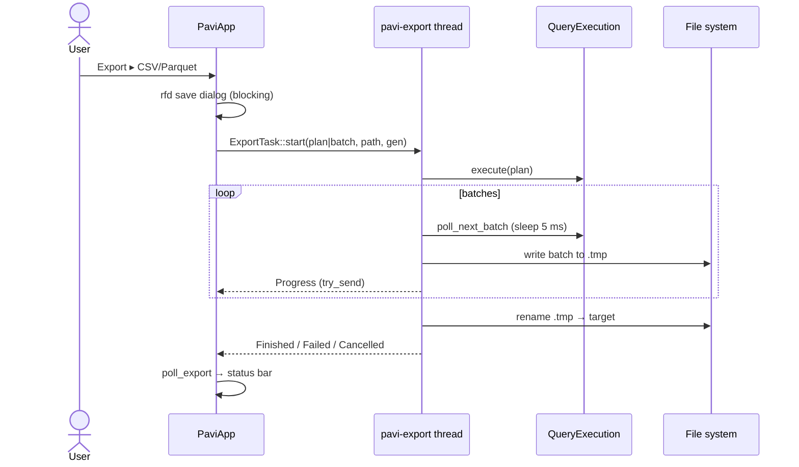
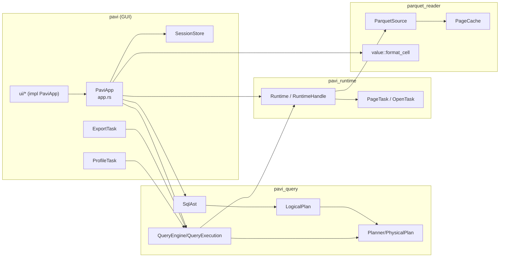
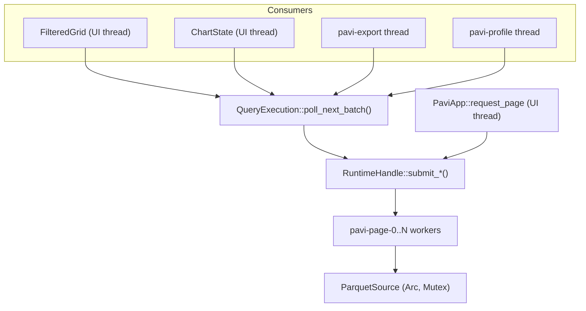

# PAVI Architecture

Snapshot of `main` at commit `1948bbf` ("UI redesigned").
All paths are relative to the repo root. Line numbers refer to that commit.

---

## TL;DR

- **What it is.** PAVI is a native Parquet explorer. The desktop app (`pavi`, egui/eframe) opens one Parquet file, shows it in a virtualized grid that loads 4,096-row pages on demand, and offers a one-predicate filter, a small SQL subset (`SELECT … FROM dataset [WHERE one predicate] [ORDER BY one column] [LIMIT n]`, plus `COUNT/SUM/AVG/MIN/MAX` with one `GROUP BY`), click-to-sort, charts, single-column profiling, an Inspector (schema, row-group statistics, file info), clipboard copy, and CSV/Parquet export. A separate `cli` binary prints metadata, schema and the first ≤1,000 rows (optionally filtered) as a box-drawn table.
- **Shape.** A layered Cargo workspace: `parquet_reader` (all Arrow/Parquet I/O, filter, sort, aggregate, cell formatting) → `pavi_runtime` (fixed std-thread worker pool with bounded channels) → `pavi_query` (SQL parser → logical plan → flattened physical plan → incremental execution) → `pavi` (GUI). The CLI uses **only** `parquet_reader`, synchronously.
- **Concurrency.** No async runtime. All file I/O runs on `pavi-page-N` worker threads (one per CPU). The UI thread submits tasks and **polls** `mpsc` receivers with `try_recv()` every frame, requesting a repaint every 16 ms while anything is pending. Stale results are discarded with a `GenerationId`. Export and profiling each get one extra short-lived thread that drives a query through the same pool.
- **Memory model.** Everything is "bounded": ≤8 UI pages + ≤8 cached source pages (128 MB), ≤8 result batches for filter/SQL/sort windows, sort ≤100,000 rows / 128 MB, group-by ≤10,000 groups / 8 MB, profile ≤4,096 distinct values, charts ≤16,384 input rows, clipboard ≤64 KB.
- **The main pattern** is a single "God struct" `PaviApp` (`crates/app/src/app.rs:292-327`) with ~35 fields; the `ui/*.rs` files are `impl PaviApp` blocks that render *and* mutate state directly (no message/command enum).
- **Tooling.** GitHub Actions CI (`.github/workflows/ci.yml`) runs `cargo fmt --check`, `cargo clippy --all-targets --all-features -D warnings`, and `cargo test --workspace` on Windows and Ubuntu (174 tests: parquet_reader 54, pavi 79, pavi_query 31, pavi_runtime 9, cli 1). No `rust-toolchain.toml`, no logging/tracing, no `unsafe`, no `cfg(target_os)`.



---

## 1. Overview

### What the app does

PAVI opens a single local Parquet file, reads only its footer metadata up front (`ParquetSource::open`, `crates/parquet/src/source.rs:125-159`), and then decodes rows lazily in fixed 4,096-row pages projected to the visible columns. On top of that it layers a deliberately small query engine (one filter, one sort key, one group-by column, limit) executed incrementally on a background thread pool, with every in-memory structure capped by an explicit budget. The GUI adds an Inspector, charts, column profiling, query history, session restore and streaming export. The CLI is a thin, synchronous preview tool for the same reader.

### Tech stack

| Area | What's used | Where |
|---|---|---|
| Language | Rust **edition 2024** in every crate; no `rust-version`/MSRV declared, no `rust-toolchain.toml`. Code uses let-chains (`if let … && let …`), which need **Rust ≥ 1.88**. Built here with rustc 1.97.1. | all `crates/*/Cargo.toml` |
| GUI | `eframe 0.31.1` with default features → **glow** (OpenGL) renderer, winit, accesskit. **No `persistence` feature.** `egui_extras 0.31` (`TableBuilder`) for the grid. No `egui_plot` — charts are hand-painted. | `Cargo.toml`, `crates/app/Cargo.toml` |
| Dialogs | `rfd 0.15` synchronous `FileDialog` (open/save) | `app.rs:444`, `app.rs:855`, `ui/toolbar.rs:115` |
| Clipboard | egui's `ctx.copy_text` (no extra crate) | `app.rs:1745`, `ui/inspector.rs:66,127` |
| Parquet/Arrow | `parquet 59` (feature `arrow`), `arrow-array/-schema/-select/-ord 59`, `arrow-cast 59` (value display rules), `arrow-array`'s `chrono-tz` feature (named time zones). **No** polars/datafusion/duckdb. | workspace `Cargo.toml` |
| SQL | `sqlparser 0.62` (GenericDialect) used only for parsing; execution is custom | `crates/query/src/sql.rs` |
| Threading | `std::thread` + `std::sync::mpsc::sync_channel` + `Arc<AtomicBool>` cancellation. No tokio, no rayon. | `crates/runtime/` |
| CLI | `clap 4` derive | `crates/cli/src/args.rs` |
| Errors | `anyhow` everywhere; small hand-written error enums in the runtime (`RuntimeConfigError`, `SubmitError`). No `thiserror`. | |
| Serialization | `serde` + `serde_json` for the session file only | `crates/app/src/session.rs` |
| Time | `chrono` (std only) for formatting file timestamps in the Inspector | `ui/inspector.rs:316` |
| Logging | **None** (no `log`/`tracing`; errors go to the status bar) | |
| Tests | built-in `#[test]` + `tempfile` dev-dep; fixtures are written with `ArrowWriter` at test time | |

---

## 2. Crate & module structure

### Crates and dependency direction

| Crate (package → target) | Kind | Responsibility | Depends on |
|---|---|---|---|
| `parquet_reader` → lib | library | Open file, metadata/statistics model, page/window reads with projection, filter evaluation & row-group pruning, in-memory sort, streaming aggregates, page cache, cell → string formatting | arrow-*, parquet, anyhow |
| `pavi_runtime` → lib | library | Fixed worker pool; typed tasks (`OpenTask`, `PageTask`) with one bounded response channel each; cooperative cancellation; generation IDs | parquet_reader |
| `pavi_query` → lib | library | SQL subset parser, `LogicalPlan` builder, `Planner` (flattens to `PhysicalPlan`), `QueryExecution` (incremental, blocking or polling) | parquet_reader, pavi_runtime, sqlparser |
| `pavi` → bin `pavi` | GUI | eframe app, all UI, export, profiling, charts, session persistence | all three libs + eframe, egui_extras, rfd, serde(_json), chrono, parquet (writer) |
| `cli` → bin `cli` | CLI | metadata + preview printer | **parquet_reader only** + clap |
| `pavi_bench` → bin `pavi-bench` | tool | prints CSV-like timing/cache metrics for open, page reads, a scan query | all three libs |

Direction is strictly downward: `app → query → runtime → parquet_reader`. No cycles. No library depends on the GUI.

### Module trees

```text
crates/parquet/src/            (parquet_reader)
├── lib.rs          re-exports the public surface
├── source.rs       ParquetSource (1,924 lines): open, read_page/window/filtered/sorted/aggregated,
│                   GroupCollector/Accumulator/Scalar (aggregation)
├── statistics.rs   row-group statistics → display text, typed by the column's Arrow type
├── metadata.rs     DatasetMetadata, RowGroupInfo, ColumnInfo, ColumnStatistics; row→row-group math
├── page.rs         PAGE_ROWS = 4096, PageKey, RowWindow, DataPage
├── cache.rs        PageCache (LRU in a VecDeque), PageCacheLimits (8 pages / 128 MB), stats
├── projection.rs   Projection (ordered, de-duplicated top-level column indexes)
├── filter.rs       FilterExpr/FilterOp: text parser, schema validation, batch evaluation, stats pruning
├── sort.rs         SortSpec, SortDirection, NullOrder, SortBudget (100k rows / 128 MB)
├── types.rs        which Arrow types each operation accepts (is_comparable, is_numeric, is_string, …)
├── aggregate.rs    AggregateFunction/Expr/Spec, GroupBudget (10k groups / 8 MB)
└── value.rs        shared value → text: format_cell* (bounded display), scalar_text (full, for CSV/profiling)

crates/runtime/src/            (pavi_runtime)
├── scheduler.rs    Runtime, RuntimeHandle, RuntimeConfig, ReadOperation, worker_loop, execute
├── task.rs         TaskId, GenerationId, PageTask, OpenTask (receiver + cancel token)
├── response.rs     PageOutcome/PageResponse, OpenOutcome/OpenResponse
└── cancellation.rs CancellationToken(Arc<AtomicBool>)

crates/query/src/              (pavi_query)
├── sql.rs          SqlAst::parse, to_logical_plan, column resolution
├── logical.rs      LogicalPlan tree (Scan/Projection/Filter/Limit/Sort/Aggregate), replace_sort
├── planner.rs      Planner::plan → PhysicalPlan (single flat struct, validated)
└── execution.rs    QueryEngine, QueryExecution (next_batch / poll_next_batch), QueryPoll

crates/app/src/                (pavi)
├── main.rs         NativeOptions + eframe::run_native
├── app.rs          PaviApp (God struct) + Dataset, FilteredGrid, ChartState, ProfileState; all actions & polling
├── app_tests.rs    33 tests driving PaviApp without a window
├── state.rs        GridState, ColumnLayout, SelectionRange, LoadState, Workspace, ToolbarCommand
├── export.rs       ExportTask (own thread), CSV writer, Parquet ArrowWriter, temp-file + rename
├── profile.rs      ProfileTask (own thread), ProfileAccumulator
├── chart.rs        ChartConfig, ChartAccumulator, ChartModel (bounded sampling/binning)
├── inspector.rs    CellDetails, column_summary, nested_schema_preview
├── session.rs      SessionState (serde), SessionStore (JSON at %LOCALAPPDATA%\PAVI\session-v1.json)
└── ui/             (mounted via #[path = "ui/mod.rs"] inside app.rs; every file is `impl PaviApp`)
    ├── toolbar.rs     top bar, Open/Recent/Export menus, custom window controls
    ├── dataset_bar.rs path box, jump-to-row
    ├── grid.rs        virtualized source grid + filtered/SQL/sort grid, keyboard, header click → sort
    ├── sql.rs         SQL workspace
    ├── inspector.rs   right panel: file info, schema, row-group stats, profile
    ├── charts.rs / profile.rs / tools.rs / status.rs
    └── theme.rs, spacing.rs, widgets.rs (colors, spacing scale, painted icons/buttons)
```

### Sharing between GUI and CLI

- **Shared:** `ParquetSource::open`, `read_window`, `read_filtered_window`, `FilterExpr::parse`, `Projection`, and the `value` module (`format_cell*` for display, `scalar_text` for CSV and profiling).
- **GUI-only:** the runtime, the query engine/SQL, sort, aggregates, page cache use (`read_page`), export, profiling, charts.
- **Duplicated logic:** CLI has its own table printer and truncation (`crates/cli/src/output.rs`). Value → text conversion lives in one place, `value.rs`: display, CSV export, profiling and row-group statistics all use it. Aggregation keeps its own typed `Scalar` values (`source.rs::scalar_at`), which are turned back into Arrow arrays and displayed through `value.rs`. Type support is defined once in `types.rs` and used by sort, aggregates, filters and profiling; CSV export uses `value::is_scalar_type`. Charts keep their own checks.

### Cargo features

None. No crate defines `[features]`, there are no optional dependencies, no `build.rs`, no `[profile.*]` overrides, no `.cargo/config.toml`, no `clippy.toml`. `--all-features` is therefore identical to a default build. eframe's own defaults are used (glow, x11, wayland, accesskit; `persistence` **off**).

---

## 3. Layered architecture

**Pattern actually used:** layered library crates underneath, and a **single God-struct App with direct mutation** on top. UI code calls `PaviApp` methods (`begin_open`, `apply_filter`, `run_sql`, `toggle_sort`, `start_export`, …) inline from inside rendering closures. The only "command"-like enum is `ToolbarCommand`, used solely to compute button enablement (`state.rs:13-40`), not to dispatch actions. Asynchronous work follows a consistent *submit task → keep receiver in a field → poll every frame → check generation* pattern.

### Entry / shell

| Type / fn | Responsibility | Ref |
|---|---|---|
| `main()` (GUI) | Takes optional path from `argv[1]`; window 1448×900 (min 900×600), **`with_decorations(false)`** (custom title bar), centered; `run_native("PAVI", …)` | `crates/app/src/main.rs:12-27` |
| `PaviApp::new` / `new_with_store` | Starts `Runtime` (worker count = CPU count, queue 32), loads session, reopens `argv[1]` or last file | `app.rs:335-396` |
| `eframe::App for PaviApp` | `update()` = poll everything then draw; `save()` = `persist_session()` but **never called** (eframe `persistence` feature off) | `app.rs:1775-1831` |
| `main()` (CLI) | `Args::parse` → open → print → preview | `crates/cli/src/main.rs:10-60` |

### UI layer

| Piece | Responsibility | Ref |
|---|---|---|
| `show_top_bar` | Open, Recent, Refresh, Filter popup, Export menu, Column types, Inspector, SQL/Grid toggle, window buttons | `ui/toolbar.rs:9-112` |
| `show_dataset_bar` | Path text box (Enter → open), jump-to-row | `ui/dataset_bar.rs` |
| `show_grid` / `show_grid_content` | Source grid via `TableBuilder::body.rows()` (virtualized); requests pages for rendered rows | `ui/grid.rs:11-196` |
| `show_filtered_grid` | Same, over `FilteredGrid.batches`; asks for more when the last row is rendered | `ui/grid.rs:198-386` |
| `render_headers` | Painted header with name/type; **click toggles sort** | `ui/grid.rs:464-562` |
| `show_inspector_panel` | File props, schema, nested preview, per-row-group stats (virtualized `show_rows`), selected cell, profile | `ui/inspector.rs` |
| `show_sql_workspace`, `show_chart_window`, `show_tools_window`, `status::show` | SQL editor, charts, history/column layout, status bar | `ui/sql.rs`, `ui/charts.rs`, `ui/tools.rs`, `ui/status.rs` |
| `theme`, `spacing`, `widgets` | Static palette, spacing scale, painted icons | `ui/theme.rs`, `ui/spacing.rs`, `ui/widgets.rs` |

### Application state

| Type | Holds | Ref |
|---|---|---|
| `PaviApp` | runtime, dataset, open task, `pending_pages: HashMap<u64, PageTask>`, `pages: HashMap<u64, DataPage>` + `page_order` (LRU ≤8), `filtered: Option<FilteredGrid>`, column layout, export/chart/profile state, text inputs, session, UI toggles, status string | `app.rs:292-327` |
| `Dataset` | `Arc<ParquetSource>`, path, column names | `app.rs:45-49` |
| `GridState` | generation, `first_row` (absolute index of the first row in a slid result window), row/column counts, load state, requested/loaded page sets, selection (absolute rows) | `state.rs:198-319` |
| `FilteredGrid` | query kind, `LogicalPlan`, running `QueryExecution`, sliding `VecDeque<RecordBatch>` (≤8), `first_result`, `rows`, `target_result` | `app.rs:76-169` |
| `ColumnLayout` | display order, hidden set, widths (72–480 px) | `state.rs:72-196` |
| `ChartState`, `ProfileState` | own generation, running execution/task, result, error | `app.rs:186-290` |
| `SessionState` | recent files (≤12), last file, SQL input, history (≤50 / 256 KB), inspector/chart visibility, per-schema grid layouts (≤8) | `session.rs:46-53` |

State changes happen by direct method calls. Every "restart" (open, filter, SQL, sort, clear) bumps `GridState.generation` via `GridState::reset()` (`state.rs:214-224`) so late responses are ignored.

### Core / domain

| Type | Responsibility | Ref |
|---|---|---|
| `DatasetMetadata`, `RowGroupInfo`, `ColumnInfo`, `ColumnStatistics` | Schema, cumulative row ranges per row group, stringified min/max/null/distinct per (column, row group) | `crates/parquet/src/metadata.rs` |
| `Projection` | Ordered unique top-level column indexes; `parquet_columns()` gives sorted order for the reader | `projection.rs` |
| `FilterExpr` | `col OP value` with `== != > >= < <= contains`. The value is parsed for the column's type (`ordered_value`): integers exactly (as `i128`), floats as `f64`, dates as `YYYY-MM-DD`, timestamps as `YYYY-MM-DD[THH:MM:SS][offset]` (read in the column's time zone when no offset is given). Row-group pruning reads statistics in the same units | `filter.rs:28-157` |
| `SortSpec`/`SortBudget`, `AggregateSpec`/`GroupBudget` | Single sort key; ≤1 group-by column with COUNT/SUM/AVG/MIN/MAX | `sort.rs`, `aggregate.rs` |
| `SqlAst` → `LogicalPlan` → `Planner` → `PhysicalPlan` | Parse → tree → validated flat struct `{projection, filter, limit, sort, aggregate}` (operator order is ignored) | `crates/query/src/{sql,logical,planner}.rs` |
| `format_cell_with_limit` / `scalar_text` | Arrow value → text. Display is truncated (nested ≤8 deep/≤16 items); `scalar_text` is full-length for scalars | `value.rs:18-97` |

### Data access

| Function | What it reads | Ref |
|---|---|---|
| `ParquetSource::open` | Footer only (`ArrowReaderMetadata::load`, default options → **no page index**); builds row-group index + statistics strings | `source.rs:125-159` |
| `reader_for` | **Re-opens the file** for every read, builds a `ParquetRecordBatchReader` with `ProjectionMask::roots`, row groups, optional `RowSelection`, batch size 4096 | `source.rs:664-686` |
| `read_window_batches` / `read_window` | Rows `[first, first+n)` → overlapping row groups + skip/select `RowSelection` | `source.rs:613-662` |
| `read_page` | `read_window` for page `i` through the `Mutex<PageCache>` | `source.rs:223-242` |
| `read_filtered_window` | Scan row groups from the start (stats-pruned), filter each batch, skip `first_match_offset` matches, return ≤n | `source.rs:244-315` |
| `read_sorted` | Load all (filtered) rows into memory under budget, `lexsort_to_indices` with a row-number tie-breaker, `take`, split into 4,096-row batches | `source.rs:320-448` |
| `read_aggregated` | Streaming row-by-row accumulation into `GroupCollector` (hash map of `Scalar` keys) | `source.rs:451-526`, `965-1177` |
| Export writers | `CsvWriter` (hand-rolled) and `parquet::arrow::ArrowWriter` to `<name>.pavi-<gen>.tmp`, then `fs::rename` | `crates/app/src/export.rs` |

Caching: two independent LRU layers of 8 pages each — `PageCache` inside `ParquetSource` (keyed by page index **and** projection, 128 MB cap) and `PaviApp.pages` (8 pages, no byte cap).

### CLI

One implicit command. Arguments (`crates/cli/src/args.rs`):

| Arg | Meaning |
|---|---|
| `FILE` (positional, required) | Parquet path |
| `--head N` (default 10) | Preview rows; rejected if >1000 (`main.rs:62-67`) |
| `--columns 0,3,5` | **Column indexes only** (names not accepted) |
| `--filter "col OP value"` | Same `FilterExpr` grammar as the GUI filter box |

Output goes to stdout: row/column/row-group counts, schema (`{:?}` of `DataType`), first 10 row-group ranges, then a box-drawn table with cells truncated to 4–32 chars. Exit codes: `0` success; `1` for any `anyhow` error (printed by Rust's `main` as `Error: …` with Debug formatting on stderr); `2` for clap usage errors.

---

## 4. Data flows

### 4.1 Open a file (GUI)

**Triggers:** `argv[1]` or last session file at startup (`app.rs:345, 392-394`); Ctrl+O (`app.rs:443-449`); toolbar Open (`ui/toolbar.rs:114-120`); Recent menu (`ui/toolbar.rs:68-72`); path box + Enter (`ui/dataset_bar.rs:37-42`); Refresh/Ctrl+R (`app.rs:432-436`). **No drag-and-drop** (`dropped_files` is never read).

**Steps**
1. `begin_open(path)` (`app.rs:643-673`, UI thread) cancels everything (open, pages, export, filter, chart, profile), clears the dataset, bumps the generation, and calls `RuntimeHandle::submit_open` → `try_send` on the bounded queue (`scheduler.rs:349-374`).
2. A worker runs `execute_open` (`scheduler.rs:516-533`) → `ParquetSource::open`: `File::open`, `ArrowReaderMetadata::load` (footer read + Arrow schema), compression set, `DatasetMetadata` + statistics strings. Result is `Arc<ParquetSource>` sent on a capacity-1 channel.
3. Each frame `update()` calls `poll_open()` (`app.rs:675-736`): `try_recv`; drops if generation differs; on success builds `Dataset`, restores the saved column layout for this schema, `grid.ready(rows, cols)`, records the recent file and **writes the session JSON synchronously**, presets chart columns.
4. The next frame renders the grid; rendering rows triggers page loads (§4.2). Inspector reads metadata already in memory.

**Thread / blocking:** footer I/O on a worker; UI thread only polls. The rfd open dialog **blocks `update()`** while it is open (normal for native modal dialogs). Session save (JSON write + `is_file()` stat on every recent file, `session.rs:139-163`) runs on the UI thread.
**Memory:** footer metadata only (`ParquetMetaData` + per-row-group stats strings).
**Errors:** `OpenOutcome::OpenFailed` → `LoadState::Error` shown centered in red in the grid area + status bar; the path is removed from recents (`app.rs:729-734`). No panics on this path.
The path submitted with the open task is kept in `opening_path` and used for the dataset and recent-file entry, so edits to the path box while loading don't affect them.



### 4.2 Scrolling / paging (unfiltered)

1. `show_grid_content` builds a `TableBuilder` with `body.rows(28 px, row_count)` (`ui/grid.rs:155-193`); egui calls the row closure only for visible rows.
2. For each visible row: `grid.visible_pages()` → `request_page(page)` (`app.rs:1286-1322`). `GridState::request_page` dedupes via `requested`/`loaded` sets. The projection is the **currently visible columns** in display order. `submit_page` → worker.
3. Each visible cell calls `cell_text` (`app.rs:1324-1345`), which also prefetches the next page when the row is a page boundary, then formats the value with `format_cell_with_limit(…, 256)` **every frame** — or shows `…` if the page isn't loaded.
4. Worker: `read_page` checks the source `PageCache` (mutex held only for lookup/insert), else `read_window_batches` decodes rows `[i·4096, (i+1)·4096)` from overlapping row groups using `RowSelection::skip/select`.
5. `poll_pages` (`app.rs:738-781`) `try_recv`s each pending task; `insert_page` keeps ≤8 pages, evicting oldest and un-marking it as loaded so it will be re-requested.
6. Jump-to-row (`ui/dataset_bar.rs:100-134`) and keyboard navigation (`ui/grid.rs:388-463`) also call `request_page` and `scroll_to_row`.

**Memory:** ≤8 UI pages × 4,096 rows × visible columns, plus ≤8 pages / 128 MB in the source cache (often the same pages → double retention of `Arc`'d arrays, mostly shared buffers).
**Back-pressure:** queue capacity 32; on `QueueFull` the request is dropped, the status bar shows `queue page N: runtime request queue is full`, and it's retried on a later frame. Pending tasks for pages scrolled past keep running.
**Errors:** `ReadFailed` → status bar message; page stays `…`.
**Column layout change** (hide/move/reset) cancels and clears all pages because the projection key changes (`app.rs:568-575`).



### 4.3 Filter (toolbar filter box)

1. `apply_filter` (`app.rs:948-1000`): `Filter::parse` (text grammar, `filter.rs:28-60`) → `LogicalPlan::scan().filter().project(all)` → `Planner::plan` validates column/type → cancel pages & previous filter → `grid.reset()` → `QueryEngine::execute`.
2. `execute` (`execution.rs:91-120`) schedules the first read: `submit_filtered_window(filter, offset 0, 4096 rows)`.
3. Worker: `read_filtered_window` (`source.rs:244-315`) iterates row groups **from the first one**, skips groups whose statistics can't match (`row_group_might_match`, `source.rs:688-703`), decodes `projection ∪ filter column`, evaluates a `BooleanArray` mask, skips the first `first_match_offset` matches, returns up to 4,096.
4. UI `poll_filtered` (`app.rs:1219-1278`) calls `poll_next_batch()` while `needs_more()`; batches go into `FilteredGrid.push`, which keeps only the last 8 batches and advances `first_result`. `grid.rows` is set to the **window size**, not the total.
5. When the last window row is rendered, `request_more_filtered` raises `target_result` by 4,096 (`ui/grid.rs:347-349`), causing the next `submit_filtered_window` with `next_filter_offset` = rows received so far — which **rescans from row group 0** again.
6. `Finished` when a window returns fewer rows than requested.

**Memory:** ≤8 batches (≈32k rows) in the UI; each worker request decodes all row groups up to the current offset.
**Errors:** parse/validation errors → red text under the filter box (`filter_error`); execution errors → `FilteredGrid.error` shown in the grid + status.



### 4.4 Sort (header click)

1. `render_headers` click → `toggle_sort(source_column)` (`ui/grid.rs:553-559`, `app.rs:1136-1203`). If a filter/SQL result is active, its plan is reused; otherwise `scan().project(all)`. `replace_sort` toggles Asc → Desc → Asc; nulls always last.
2. `execute` submits **one** `ReadOperation::Sorted` (`execution.rs:351-365`).
3. Worker `read_sorted` (`source.rs:320-448`): first rejects if the **whole file** has more rows than the budget (100,000) — before applying the filter or limit. Otherwise it materializes all (filtered) rows, checks a byte estimate, sorts with a stable tie-breaker, `take`s output columns and splits into 4,096-row batches.
4. All sorted batches are moved into `QueryExecution.buffered` at once; the UI then drains them into its 8-batch window like a filter.

**Memory:** up to 100k rows / 128 MB of decoded input plus the sorted copy on the worker; the full sorted result sits in `QueryExecution.buffered` until consumed.
**Errors:** budget error text ("sort input has N rows, exceeding the in-memory sort budget…") ends up in the status bar / grid error.
"Return to source order" = `clear_filter` (`ui/toolbar.rs:96`).



### 4.5 SQL (SQL workspace) and aggregates

1. `run_sql` (`app.rs:1029-1111`): `SqlAst::parse` (`sql.rs:61-95`) enforces the subset (one statement, `SELECT`, `FROM dataset` only, one predicate, one `ORDER BY` column, `LIMIT`, optional single `GROUP BY` + aggregates). Column names are resolved case-insensitively (`sql.rs:486-506`). → `to_logical_plan` → `Planner::plan`.
2. Execution picks one strategy in `schedule_next` (`execution.rs:319-433`), by precedence: **aggregate** (one `Aggregated` task) → **sort** (one `Sorted` task) → **filter** (repeated filtered windows) → **plain scan** (`Page` tasks, or a final `Window` for the LIMIT remainder).
3. Aggregates (`read_aggregated`, `source.rs:451-526`) stream all row groups, converting every value to a `Scalar` and updating accumulators per row; `COUNT(*)` with no filter uses the metadata row count (fast path, `source.rs:481-485`).
4. Results flow into the same `FilteredGrid`. History is recorded with duration/row count on finish/failure (`app.rs:628-641`) and the session is saved.

Errors: parse/plan errors → red text in SQL workspace (`sql_error`) + failed history entry; runtime errors → grid error + status.



### 4.6 Inspector: schema, metadata, row-group statistics, profiling

- **Metadata/schema/stats** are computed once at open (`statistics::metadata_statistics`; min/max rebuilt as typed values and formatted like grid cells, byte strings capped at 128 chars) and rendered from memory each frame; long lists use `ScrollArea::show_rows` (virtualized) (`ui/inspector.rs:203-240`). For schemas with nested columns (top-level count ≠ leaf count), **all statistics are dropped** (`statistics.rs`).
- **Selected cell:** `selected_cell_details` → `inspect_cell` on the in-memory batch (`app.rs:1560-1603`).
- **Profile column:** `run_profile` (`app.rs:1482-1503`) → `ProfileTask::start` spawns thread `pavi-profile` (`profile.rs:83-119`), which runs a `scan().project([col])` query and polls it with a 5 ms sleep loop (`profile.rs:143-176`), building exact distinct counts, min/max/mean, string lengths and a distribution chart. Result returns via a capacity-1 channel; UI polls in `poll_profile` (`app.rs:1513-1543`). Exact distinct counting is capped at 4,096 values and 128 bytes per value; past that the profile ends with an error (`profile.rs:275-294`).



### 4.7 Export and clipboard

- **Export** (`app.rs:842-886`, `export.rs:76-206`): save dialog (blocks UI), build `ExportInput` = the current filter/SQL/sort `LogicalPlan`, or a full-scan plan, or one selected row; spawn `pavi-export` thread. It writes to `<file>.pavi-<gen>.tmp`, driving `poll_next_batch` with a 5 ms sleep loop, writing each batch to CSV or `ArrowWriter`, sending best-effort progress (`try_send`, capacity 1), then `fs::rename` to the target. Cancel/failure deletes the temp file. CSV accepts every non-nested type and writes each field with `value::scalar_text`, the same text the grid shows, untruncated; nulls are empty fields and binary is `0x`-prefixed hex.
- **Copy:** Ctrl+C copies the selected cell range (TSV) from in-memory batches (`app.rs:1659-1751`) using the same 256-char display formatting, capped at 64 KB; fails if any selected row has been evicted from the window.



### 4.8 Charts

`run_chart` (`app.rs:1352-1414`): either uses the current 8-batch result window synchronously on the UI thread (small), or runs a chart SQL query whose batches are fed to `ChartAccumulator` in `poll_chart` (`app.rs:1433-1480`) until 16,384 input rows, then cancels the query. Rendering is custom painting in `ui/charts.rs`.

### 4.9 CLI

```mermaid
sequenceDiagram
    actor Shell
    participant M as cli main
    participant PS as ParquetSource
    participant O as output::print_batch
    Shell->>M: cli FILE [--head N] [--columns i,j] [--filter "c OP v"]
    M->>M: Args::parse (clap; usage error → exit 2)
    M->>M: validate_head (≤1000)
    M->>PS: open(FILE)
    M->>M: parse_columns (indexes only)
    M->>Shell: Rows / Columns / Row groups / Schema / ≤10 row-group ranges
    alt --filter
        M->>PS: read_filtered_window(filter, 0, N, proj)
    else
        M->>PS: read_window(0, N, proj)
    end
    M->>O: print_batch → box table to stdout
    M-->>Shell: exit 0, or anyhow error → stderr, exit 1
```

All of it runs on the main thread; memory is ≤1,000 rows of the projected columns (a selective filter may still scan the whole file).

---

## 5. Frame loop, state & concurrency

### What `update()` does every frame (`app.rs:1780-1831`)

1. Apply theme once; `handle_global_shortcuts` (may open a blocking rfd dialog on Ctrl+O).
2. Poll: `poll_open`, `poll_pages` (iterates all pending page tasks), `poll_filtered` (drains available batches), `poll_chart`, `poll_profile`, `poll_export`. All are `try_recv` — no blocking waits.
3. Draw top bar, chart window, status bar, inspector, tools window, central grid/SQL workspace.
4. If anything is pending → `request_repaint_after(16 ms)`.

**Per-frame allocations worth knowing:** `column_names.clone()` and a fresh `Vec<Header>` (with `type_label` strings and `source.schema()` `Arc` clones per column) in the grid (`ui/grid.rs:72-102`); `display_columns.clone()` for filtered grids (`ui/grid.rs:211`); one `String` per visible cell from `format_cell_with_limit` (≤256 chars) plus `on_hover_text(text)` per cell. With ~40 visible rows × ~15 columns this is a few hundred small strings per frame — fine, but formatting is not cached between frames. No large data is cloned per frame (`RecordBatch` clones are `Arc` bumps).

**Cached between frames:** decoded pages/batches, metadata, column layout, chart/profile models, status strings.

### Background work and cancellation

| Work | Thread | Cancel mechanism | Effective? |
|---|---|---|---|
| Open, page, window, filter window, sort, aggregate | `pavi-page-N` pool (N = CPU count, `scheduler.rs:27-36`) | `CancellationToken` checked **before and after** the read (`scheduler.rs:535-569`) | Only for queued tasks. A running full-file sort/aggregate/filter scan runs to completion. |
| Export | `pavi-export` (one per export) | token checked between batches | Yes, at batch granularity |
| Profile | `pavi-profile` | token checked between polls | Yes, but the in-flight pool task still completes |
| Stale results | — | `GenerationId` per grid / chart / profile / export | Yes; late responses are dropped |

Opening a new file cancels all of the above (`app.rs:643-660`). If the user acts while loading, the newest action bumps the generation and results from older actions are ignored, but their worker time is still spent. All consumers share the one pool: a long sort/aggregate occupies a worker until done; grid page reads, filters, charts, profiling and export all queue on the same workers.

**Shutdown:** `Runtime` is dropped with `PaviApp`; `Drop` → `shutdown()` **joins** all workers (`scheduler.rs:279-287, 494-498`), so closing the window waits for any in-progress scan to finish. Export/profile threads are detached.

### Shared state

- `ParquetSource.cache: Mutex<PageCache>` — locked only around `get`/`insert`, never across decoding or UI rendering. Two workers can decode the same missing page concurrently (no in-flight dedupe); harmless.
- `Runtime.submissions: Arc<Mutex<Option<SyncSender>>>` — locked briefly to clone the sender.
- Worker receiver `Arc<Mutex<Receiver>>` — the standard shared-receiver pattern; a worker holds the lock while blocked in `recv()`, which serializes dequeueing but not execution.
- Atomics: task ID counter, shutdown flag, cancellation flags.
- No `RwLock`, no locks touched by the UI thread except via `ParquetSource::cache_stats` (Inspector). No lock is held across rendering.

### Persistence

Custom JSON session at `%LOCALAPPDATA%\PAVI\session-v1.json` (falls back to the temp dir on systems without `LOCALAPPDATA`) (`session.rs:192-199`), written atomically via `.tmp` + rename (`session.rs:213-229`). It stores recent files, last file, SQL input, query history, inspector/chart visibility and per-schema grid layouts (order, hidden, widths). It's saved synchronously on many actions (open, SQL run/finish, layout change, inspector toggle). eframe's own storage is unused: `App::save` is implemented but eframe only calls it with the `persistence` feature, which is off; window size/position are not persisted.

---

## 6. Dependency graph

### Crate/component level



### Abstraction boundaries

There are almost no traits. The boundaries are concrete types:
- `Arc<ParquetSource>` is the only "data source"; `LogicalPlan::Scan` hard-codes it (`logical.rs:8-11`). `arch.md` envisions a generic data-source layer, but no trait exists.
- `RuntimeHandle` (cloneable) is the boundary between query/app and threads.
- `QueryPoll` / `QueryExecution::poll_next_batch` is the boundary between event-loop consumers and the engine.
- The only trait is private: `export.rs::BatchSource` (one-batch vs query-backed input).



---

## 7. External boundaries

### File system
- One local file per session, by path (`File::open`). No globbing, directories, multi-file datasets, URLs or object storage.
- The file is **re-opened by path for every read** (`source.rs:670-671`); metadata is cached from open time. If the file changes on disk, reads use stale metadata against new bytes.
- Writes: export target (+ temp file next to it) and the session JSON.

### Parquet/Arrow features
| Feature | Status |
|---|---|
| Column projection | Top-level roots only (`ProjectionMask::roots`); nested columns are read whole (tested: `source.rs:1735`) |
| Row-group pruning | For filters, using min/max stats — **disabled entirely for nested schemas** (`source.rs:694-696`) |
| Page index / bloom filters | Not used (`ArrowReaderMetadata::load(&file, Default::default())`) |
| Display formatting (`value.rs`) | Ints, floats and bools via `Display`; strings (Utf8/LargeUtf8/Utf8View) as-is; binary types as hex; dictionary cells show the referenced value. Dates, timestamps, times, durations, intervals, decimals, Float16 and run-end-encoded values use arrow-cast's rules: `2022-01-08`, naive `2023-11-14T22:13:20`, zoned `2023-11-14T23:13:20+01:00` (UTC as `Z`), `123.45`, `PT90S`. `Date64` shows as a date-time. List/LargeList/FixedSizeList/Struct/Map are bounded (≤8 deep, ≤16 items). |
| Comparable types (`types::is_comparable`) | Bool, ints, floats, Utf8/LargeUtf8/Utf8View, Date32/64, Timestamp (any unit, with or without a time zone). |
| Filter types | Comparable types. Bool supports `==`/`!=`; `contains` is text-only. Not: decimals, times, binary, dictionaries, nested. |
| Sort types | Comparable types |
| MIN/MAX/GROUP BY types | Comparable types; results keep the input type (including time zone). SUM/AVG: ints and floats. |
| CSV export types | every non-nested type, as the shared display text (ISO dates, RFC 3339 timestamps, scaled decimals) |
| Profiling types | Comparable types. Numbers get a mean and histogram, text gets lengths, dates/timestamps are ordered by time (not text). |
| Statistics display | Rebuilt as the column's Arrow type and formatted like grid values: unsigned integers, dates, times, timestamps (in their zone) and decimals (INT32/INT64/byte-array storage). INT96 and other physical types show the stored value. |
| Files written by polars (the repo's sample data) | Strings load as `LargeUtf8` (e.g. `dummy_5m`, `dummy_1b`), which every operation accepts like `Utf8`. |
| Large files | Row counts are `u64`; the grid casts to `usize` and uses egui `f32` pixel math |

### Platform-specific code
- No `cfg(target_os)` anywhere. Implicitly Windows-oriented: session path uses `LOCALAPPDATA` (`session.rs:192-199`).
- Window decorations are disabled on all platforms; the toolbar draws its own drag/maximize/close controls (`ui/toolbar.rs:26-55`, `159-163`).
- Native dialogs: `rfd` (synchronous). Clipboard: egui/winit.

### unsafe / FFI
None in workspace code. Native code exists only transitively (zstd-sys, OpenGL via glow, OS dialogs via rfd).
