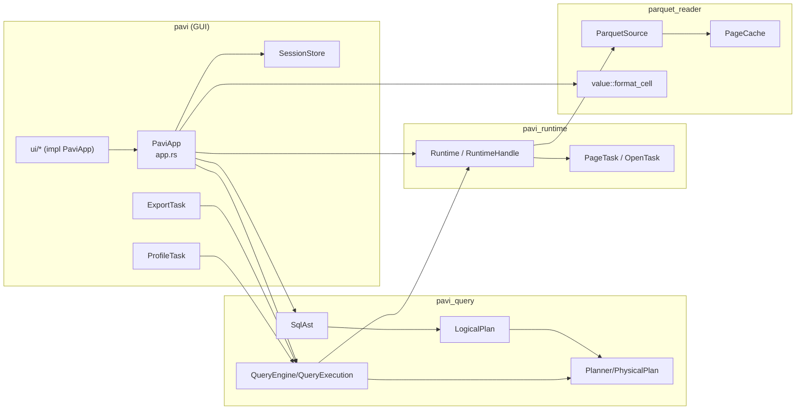
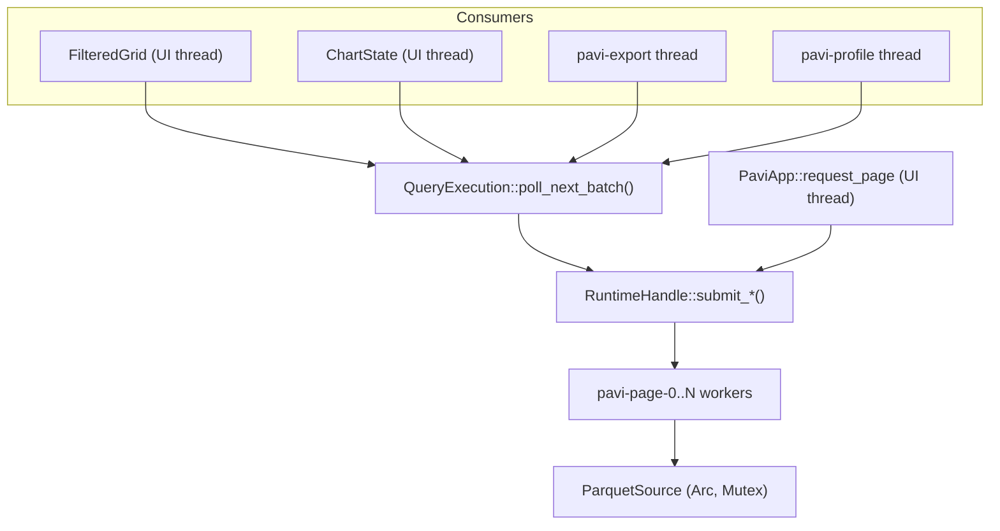

# Frame loop, concurrency and dependencies

> Part of the [architecture docs](../ARCHITECTURE.md). `file:line` references can drift; search for the symbol name if a line doesn't match.

## What `update()` does every frame (`app.rs:1780-1831`)

1. Apply theme once; `handle_global_shortcuts` (may open a blocking rfd dialog on Ctrl+O).
2. Poll: `poll_open`, `SourcePages::poll` (iterates all pending page tasks), `poll_filtered` (drains available batches), `poll_chart`, `poll_profile`, `poll_export`. All are `try_recv` — no blocking waits.
3. Draw top bar, chart window, status bar, inspector, central grid/SQL workspace.
4. If anything is pending → `request_repaint_after(16 ms)`.

**Per-frame allocations worth knowing:** `column_names.clone()` and a fresh `Vec<Header>` (with `type_label` strings and `source.schema()` `Arc` clones per column) in the grid (`ui/grid.rs:72-102`); `display_columns.clone()` for filtered grids (`ui/grid.rs:211`); one `String` per visible cell from `format_cell_with_limit` (≤256 chars) plus `on_hover_text(text)` per cell. With ~40 visible rows × ~15 columns this is a few hundred small strings per frame — fine, but formatting is not cached between frames. No large data is cloned per frame (`RecordBatch` clones are `Arc` bumps).

**Cached between frames:** decoded pages/batches, metadata, column layout, chart/profile models, status strings.

## Background work and cancellation

| Work | Thread | Cancel mechanism | Effective? |
|---|---|---|---|
| Open, page, window, filtered read, sort, aggregate | `pavi-page-N` pool (N = CPU count) | `CancellationToken` and the runtime's shutdown flag, combined into a `stop` check (`scheduler.rs::execute`). Checked before and after every read. Filtered/sorted/aggregated scans call the runtime's `checkpoint(scanned_rows)` before each 4,096-row batch: it stores the scan position in the task's `ScanProgress` (an `Arc<AtomicU64>`, written by the worker and read by the UI with relaxed ordering; it is a display value and guards nothing) and returns the `stop` check. A stopped scan returns `parquet_reader::Cancelled`, reported as `PageOutcome::Cancelled` | Yes; a running scan stops within one batch (sub-millisecond on the sample files) |
| Export | `pavi-export` (one per export) | token checked between batches | Yes, at batch granularity |
| Profile | `pavi-profile` | token checked between polls; cancels its query's pool task | Yes, at batch granularity |
| Panics in a read or open | worker thread | `guarded` (`catch_unwind`) turns the panic into `ReadFailed` / `OpenFailed` | Yes; the worker survives and the pool keeps its size |
| Stale results | — | `GenerationId` per grid / chart / profile / export | Yes; late responses are dropped |

Opening a new file cancels all of the above (`app.rs:643-660`). If the user acts while loading, the newest action bumps the generation and results from older actions are ignored; replaced filter/SQL/sort/chart queries are cancelled, so their scans stop within a batch. All consumers share the one pool; grid page reads, filters, charts, profiling and export all queue on the same workers.

**Shutdown:** `Runtime` is dropped with `PaviApp`; `Drop` → `shutdown()` sets the shutdown flag, closes the queue and joins the workers. Running scans see the flag before their next batch, so closing the window doesn't wait for them to finish. Export/profile threads are detached.

## Shared state

- `ParquetSource.cache: Mutex<PageCache>` — locked only around `get`/`insert`, never across decoding or UI rendering. Two workers can decode the same missing page concurrently (no in-flight dedupe); harmless.
- `Runtime.submissions: Arc<Mutex<Option<SyncSender>>>` — locked briefly to clone the sender.
- Worker receiver `Arc<Mutex<Receiver>>` — the standard shared-receiver pattern; a worker holds the lock while blocked in `recv()`, which serializes dequeueing but not execution.
- Atomics: task ID counter, shutdown flag, cancellation flags.
- No `RwLock`, no locks touched by the UI thread except via `ParquetSource::cache_stats` (Inspector). No lock is held across rendering.

## Query preparation

A query that joins tables or uses subqueries (ADR 0009) is prepared on its own thread, `pavi-query-prep`, like export and profiling. It drives subqueries through `QueryEngine` (whose reads run on the worker pool) and reads join inputs directly with `parquet_reader`. Because it is not a pool worker, a subquery waiting on the pool can't deadlock it. It checks a cancellation flag between batches and stores its progress in an atomic; `QueryExecution` polls its one-slot result channel each frame.

## Network reads

Remote reads (ADR 0008) are blocking HTTP requests made on the worker that runs the read, through one shared `ureq` agent (connection pool). The range cache of a `RemoteObject` is behind a `Mutex` held only to look up or insert a range, never during a request. Cancellation is checked between batches as for local files; a request already sent runs until it answers or times out.

## Tabs

Only the open tab is polled. A parked tab keeps its `OpenTask`, page tasks, `QueryExecution` and export/profile receivers; workers finish their reads and send into those one-slot channels, which never block because each holds one response. The results are picked up, and checked against the tab's own `GridState.generation`, when the tab is shown again. An export keeps writing while its tab is parked. Closing a tab cancels all of its work.

## Persistence

Custom JSON session at `%LOCALAPPDATA%\PAVI\session-v1.json` (falls back to the temp dir on systems without `LOCALAPPDATA`) (`session.rs:192-199`), written atomically via `.tmp` + rename (`session.rs:213-229`). It stores recent files and folders, last file, the files and folders open in tabs (reopened at start), SQL input, query history, inspector/chart visibility and per-schema grid layouts (order, hidden, widths). It's saved synchronously on many actions (open, SQL run/finish, layout change, inspector toggle). eframe's own storage is unused: `App::save` is implemented but eframe only calls it with the `persistence` feature, which is off; window size/position are not persisted.

## Dependency graph

### Crate/component level

### Abstraction boundaries

There are almost no traits. The boundaries are concrete types:
- `Arc<ParquetSource>` is the only "data source"; `LogicalPlan::Scan` hard-codes it (`logical.rs`); there is no data-source trait.
- `RuntimeHandle` (cloneable) is the boundary between query/app and threads.
- `QueryPoll` / `QueryExecution::poll_next_batch` is the boundary between event-loop consumers and the engine.
- The only trait is private: `export.rs::BatchSource` (one-batch vs query-backed input).

