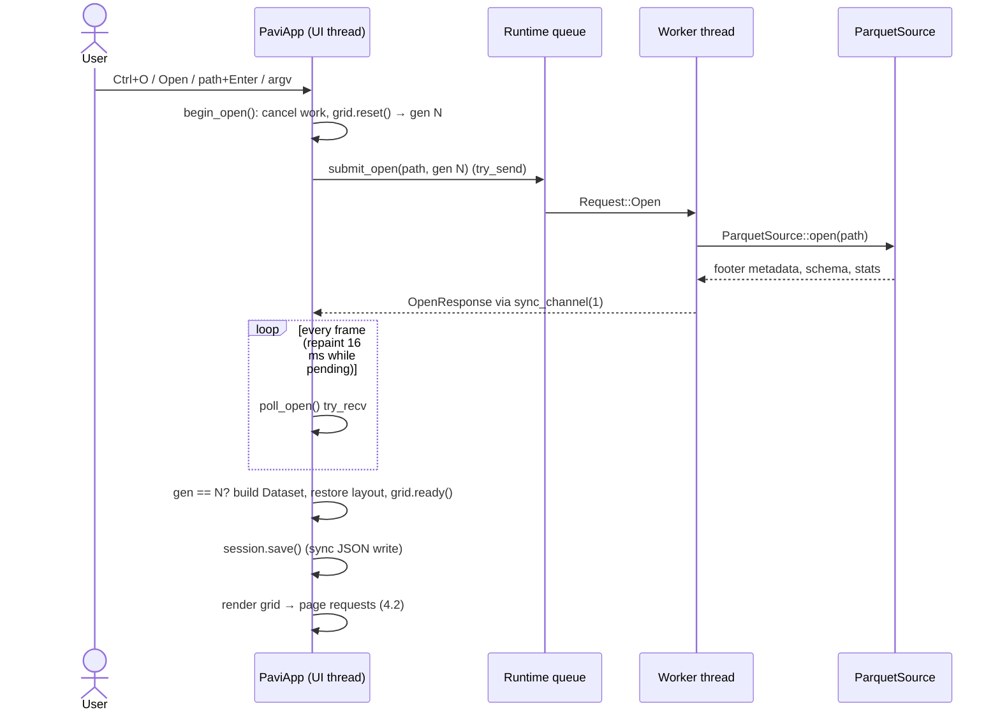
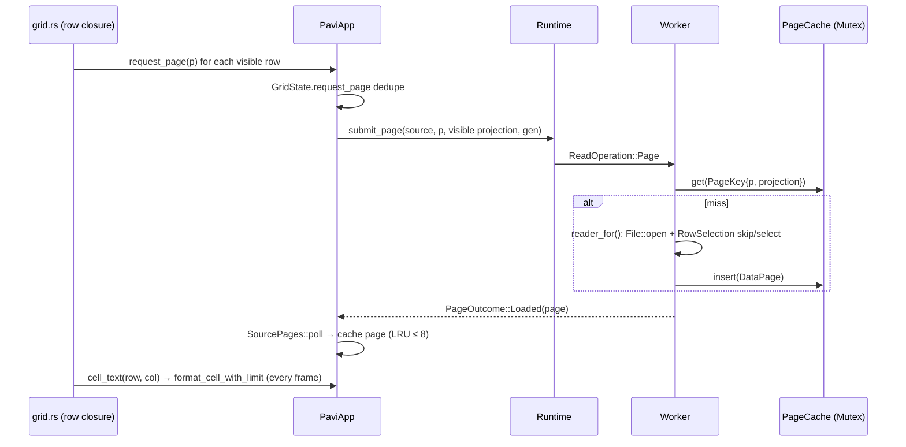
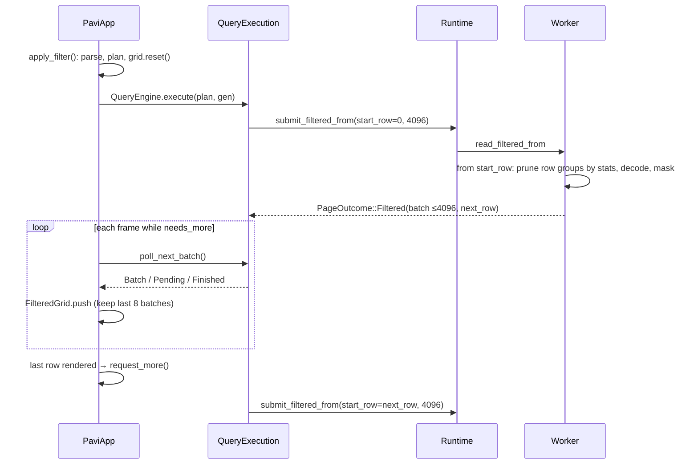
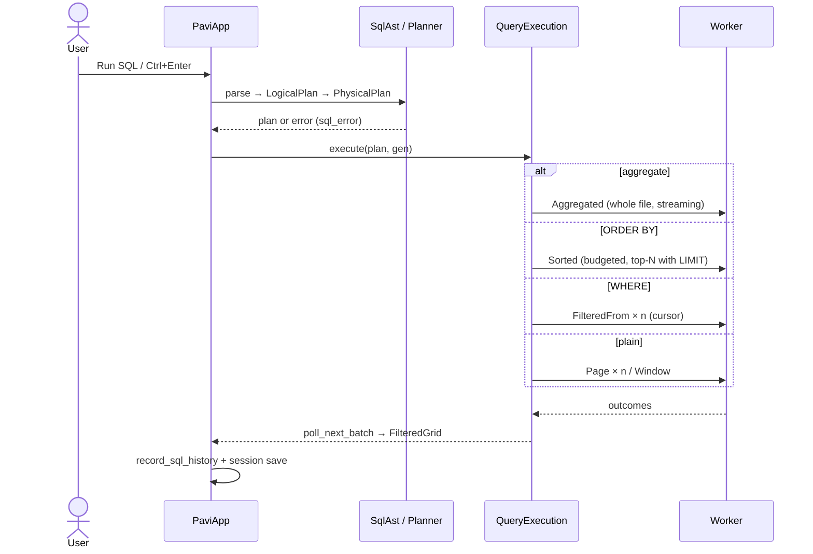
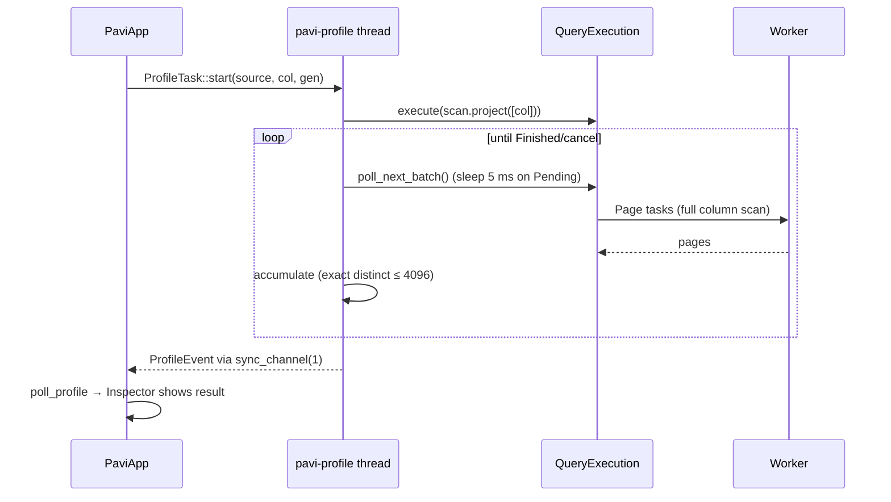
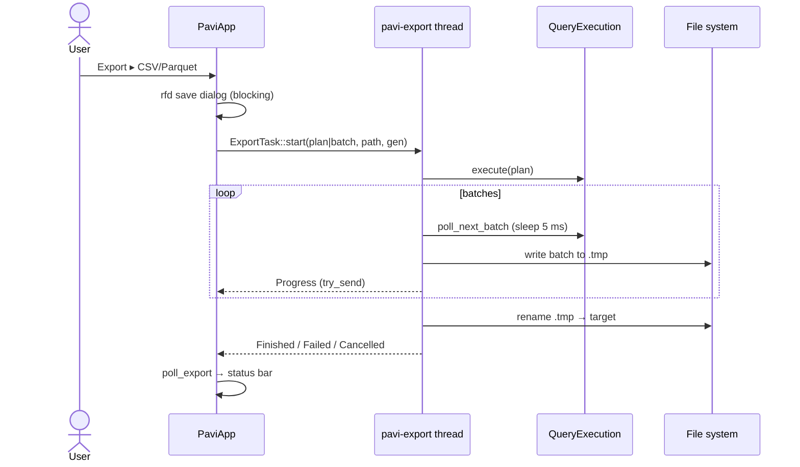

# Data flows

> Part of the [architecture docs](../ARCHITECTURE.md). `file:line` references can drift; search for the symbol name if a line doesn't match.

## 4.1 Open a file (GUI)

**Triggers:** `argv[1]` or last session file at startup (`app.rs:345, 392-394`); Ctrl+O (`handle_global_shortcuts`); the file menu in the top bar (`file_menu` in `ui/toolbar.rs`: Browse, a recent file, or the path box + Enter); Browse or a recent file on the start screen (`show_closed_state` in `ui/grid.rs`); a file dropped on the window (`open_dropped_file`, first dropped file only); Reload/Ctrl+R.

**Steps**
1. `begin_open(path)` (`app.rs:643-673`, UI thread) cancels everything (open, pages, export, filter, chart, profile), clears the dataset, bumps the generation, and calls `RuntimeHandle::submit_open` → `try_send` on the bounded queue (`scheduler.rs:349-374`).
2. A worker runs `execute_open` (`scheduler.rs:516-533`) → `ParquetSource::open`: `File::open`, `footer::check_footer` (rejects impossible collection sizes and schema child counts before the parser sees them), `ArrowReaderMetadata::load` (footer read + Arrow schema), compression set, `DatasetMetadata` + statistics strings. Result is `Arc<ParquetSource>` sent on a capacity-1 channel.
3. Each frame `update()` calls `poll_open()` (`app.rs:675-736`): `try_recv`; drops if generation differs; on success builds `Dataset`, restores the saved column layout for this schema, `grid.ready(rows, cols)`, records the recent file and **writes the session JSON synchronously**, presets chart columns.
4. The next frame renders the grid; rendering rows triggers page loads (§4.2). Inspector reads metadata already in memory.

**Thread / blocking:** footer I/O on a worker; UI thread only polls. The rfd open dialog **blocks `update()`** while it is open (normal for native modal dialogs). Session save (JSON write + `is_file()` stat on every recent file, `session.rs:139-163`) runs on the UI thread.
**Memory:** footer metadata only (`ParquetMetaData` + per-row-group stats strings).
**Errors:** `OpenOutcome::OpenFailed` → `LoadState::Error` shown centered in red in the grid area + status bar; the path is removed from recents (`app.rs:729-734`). No panics on this path.
The path submitted with the open task is kept in `opening_path` and used for the dataset and recent-file entry, so edits to the path box while loading don't affect them.



## 4.2 Scrolling / paging (unfiltered)

1. `show_grid_content` builds a `TableBuilder` with `body.rows(24 px, rows)`; egui calls the row closure only for visible rows. Files with more than `GRID_WINDOW_ROWS` (500,000) rows are **windowed**, because egui lays rows out in `f32` points, which stop being exact past about 16.7 million points (≈700,000 rows):
   - The table holds only 500,000 rows starting at `GridState::window_base`; row closure indexes are offset by it, so selection, page requests and cell text use absolute rows.
   - The table's own scrollbar is hidden. PAVI draws `row_scrollbar` in a 12 px strip on the right. Its thumb shows the drawn rows within the whole file, and clicking or dragging it scrolls there (`scroll_grid_to`).
   - After each frame, if the drawn rows are within a quarter window of an inner edge, `GridState::recentered_base` picks a window centred on them. The table's post-frame scroll offset is shifted by the same number of rows, so the view doesn't move.
2. For each visible row: `grid.visible_pages()` → `request_page(page)` (`app.rs:1286-1322`). `GridState::request_page` dedupes via `requested`/`loaded` sets. The projection is the **currently visible columns** in display order. `submit_page` → worker.
3. Each visible cell calls `cell_text` (`app.rs:1324-1345`), which also prefetches the next page when the row is a page boundary, then formats the value with `format_cell_with_limit(…, 256)` **every frame** — or shows `…` if the page isn't loaded.
4. Worker: `read_page` checks the source `PageCache` (mutex held only for lookup/insert), else `read_window_batches` decodes rows `[i·4096, (i+1)·4096)` from overlapping row groups using `RowSelection::skip/select`.
5. `SourcePages::poll` (`pages.rs`) `try_recv`s each pending task and keeps ≤8 loaded pages, evicting the oldest and un-marking it as loaded so it will be re-requested.
6. Jump-to-row (the "Go to row" box in `ui/status.rs`, handled by `jump_to_input`) and keyboard navigation (`ui/grid.rs`) also call `request_page`. Jumps use `scroll_to_row`; in windowed grids they instead move the window around the target and set the scroll offset directly, which applies in the same frame.

**Memory:** ≤8 UI pages × 4,096 rows × visible columns, plus ≤8 pages / 128 MB in the source cache (often the same pages → double retention of `Arc`'d arrays, mostly shared buffers).
**Back-pressure:** queue capacity 32; on `QueueFull` the request is dropped, the status bar shows `queue page N: runtime request queue is full`, and it's retried on a later frame. After drawing, the grid cancels pending page reads more than one page away from the pages it drew (`cancel_offscreen_pages`), except pages requested in the same frame such as a jump target; they are requested again if they scroll back into view.
**Errors:** `ReadFailed` → status bar message; page stays `…`.
**Column layout change** (hide/move/reset) cancels and clears all pages because the projection key changes (`app.rs:568-575`).



## 4.3 Filter (toolbar filter box)

1. `apply_filter` (`app.rs:948-1000`): `Filter::parse` (text grammar, `filter.rs:28-60`) → `LogicalPlan::scan().filter().project(all)` → `Planner::plan` validates column/type → cancel pages & previous filter → `grid.reset()` → `QueryEngine::execute`.
2. `execute` (`execution.rs:91-120`) schedules the first read: `submit_filtered_from(filter, start_row 0, 4096 rows)`.
3. Worker: `read_filtered_from` starts at `start_row`, skips row groups whose statistics can't match (`row_group_might_match`), decodes `projection ∪ filter column`, evaluates a `BooleanArray` mask, and returns up to 4,096 matches as `PageOutcome::Filtered` with `next_row`.
4. UI `poll_filtered` (`app.rs:1219-1278`) calls `poll_next_batch()` while `needs_more()`; batches go into `FilteredGrid.push`, which keeps only the last 8 batches and advances `first_result`. `grid.rows` is set to the **window size**, not the total.
5. When the last window row is rendered, `request_more_filtered` raises `target_result` by 4,096 (`ui/grid.rs:347-349`), causing the next `submit_filtered_from` at `next_filter_row`, the cursor returned by the previous read.
6. `Finished` when `next_row` reaches the file's row count.

**Memory:** ≤8 batches (≈32k rows) in the UI. Each worker request decodes only from the cursor onward, so reading a whole filtered result (scrolling to the end, export) touches each row once.
**Errors:** parse/validation errors → red text under the filter box (`filter_error`); execution errors → `FilteredGrid.error` shown in the grid + status.



## 4.4 Sort (Sort menu, header right-click)

1. The Sort menu in the top bar calls `toggle_sort(source_column)` (Asc → Desc → Asc). A right-click on a grid header offers "Sort ascending" / "Sort descending": `render_headers` stores a `HeaderAction`, and `apply_header_action` runs it after the table is drawn. Both end in `sort_column(column, direction)`. A plain header click only selects the column (`HeaderAction::Select`); it never starts a scan. If a filter/SQL result is active, its plan is reused; otherwise `scan().project(all)`. Nulls are always last.
2. If the plan has no `LIMIT`, `sort_column` adds `LIMIT SORT_ROW_CAP` (100,000, the sort budget's row cap) and marks the result `sort_capped`; the status bar and the result strip say that only the first 100,000 rows in sort order are shown. A SQL `LIMIT` is left as written.
3. `execute` submits **one** `ReadOperation::Sorted` with a `SortedRead { sort, budget, limit }` (`execution.rs`).
4. Worker `read_sorted`: with `LIMIT n` (n ≤ 100,000) only the best n rows are kept while scanning, so any file size works. That is the path every GUI sort takes. Without a limit (or with a larger SQL `LIMIT`) it buffers the rows that pass the filter, and more than 100,000 of them (or the byte estimate) is an error. It sorts with a stable tie-breaker, `take`s output columns and splits into 4,096-row batches.
5. All sorted batches are moved into `QueryExecution.buffered` at once; the UI then drains them into its 8-batch window like a filter.

**Memory:** up to 100k filtered rows / 128 MB of decoded input plus the sorted copy on the worker (top-N: about n + 32k rows); the sorted result sits in `QueryExecution.buffered` until consumed.
**Errors:** budget error text ("sort input exceeds the in-memory sort budget… filter the data or add a LIMIT…") ends up in the status bar / grid error. GUI sorts can still hit the 128 MB byte budget on very wide rows.
"Back to file order" in the Sort menu = `clear_filter`.

```mermaid
sequenceDiagram
    participant H as Sort menu / header menu
    participant UI as PaviApp
    participant Q as QueryExecution
    participant W as Worker
    H->>UI: sort_column(col, dir)
    UI->>UI: plan.replace_sort(col, dir, NullsLast), add LIMIT 100k if none
    UI->>Q: execute(plan)
    Q->>W: ReadOperation::Sorted (one task)
    W->>W: scan + filter; LIMIT n: keep best n rows, else > 100k rows → error
    W->>W: lexsort (value, sequence), take, slice 4096
    W-->>Q: PageOutcome::Batches(all)
    Q-->>UI: batches one per poll → 8-batch window
```

## 4.5 SQL (SQL workspace) and aggregates

1. `run_sql` (`app.rs:1029-1111`): `SqlAst::parse` (`sql.rs:61-95`) enforces the subset (one statement, `SELECT`, `FROM dataset` only, one predicate, one `ORDER BY` column, `LIMIT`, optional single `GROUP BY` + aggregates). Column names are resolved case-insensitively (`sql.rs:486-506`). → `to_logical_plan` → `Planner::plan`.
2. Execution picks one strategy in `schedule_next` (`execution.rs:319-433`), by precedence: **aggregate** (one `Aggregated` task) → **sort** (one `Sorted` task) → **filter** (repeated filtered reads, each resuming at the previous cursor) → **plain scan** (`Page` tasks, or a final `Window` for the LIMIT remainder).
3. Aggregates (`read_aggregated`, `source.rs:451-526`) stream all row groups, converting every value to a `Scalar` and updating accumulators per row; `COUNT(*)` with no filter uses the metadata row count (fast path, `source.rs:481-485`).
4. Results flow into the same `FilteredGrid`. History is recorded with duration/row count on finish/failure (`app.rs:628-641`) and the session is saved.

Errors: parse/plan errors → red text in SQL workspace (`sql_error`) + failed history entry; runtime errors → grid error + status.



## 4.6 Inspector: schema, metadata, row-group statistics, profiling

- **Metadata/schema/stats** are computed once at open (`statistics::metadata_statistics`; min/max rebuilt as typed values and formatted like grid cells, byte strings capped at 128 chars) and rendered from memory each frame; long lists use `ScrollArea::show_rows` (virtualized) (`ui/inspector.rs:203-240`). For schemas with nested columns (top-level count ≠ leaf count), **all statistics are dropped** (`statistics.rs`).
- **Selected cell:** `selected_cell_details` → `inspect_cell` on the in-memory batch (`app.rs:1560-1603`).
- **Profile column:** `run_profile` (`app.rs:1482-1503`) → `ProfileTask::start` spawns thread `pavi-profile` (`profile.rs:83-119`), which runs a `scan().project([col])` query and polls it with a 5 ms sleep loop (`profile.rs:143-176`), building exact distinct counts, min/max/mean, string lengths and a distribution chart. Result returns via a capacity-1 channel; UI polls in `poll_profile` (`app.rs:1513-1543`). Exact distinct counting is capped at 4,096 values and 128 bytes per value; past that the profile ends with an error (`profile.rs:275-294`).



## 4.7 Export and clipboard

- **Export** (`app.rs:842-886`, `export.rs:76-206`): save dialog (blocks UI), build `ExportInput` = the current filter/SQL/sort `LogicalPlan`, or a full-scan plan, or one selected row; spawn `pavi-export` thread. It writes to `<file>.pavi-<gen>.tmp`, driving `poll_next_batch` with a 5 ms sleep loop, writing each batch to CSV or `ArrowWriter`, sending best-effort progress (`try_send`, capacity 1), then `fs::rename` to the target. Cancel/failure deletes the temp file. CSV accepts every non-nested type and writes each field with `value::scalar_text`, the same text the grid shows, untruncated; nulls are empty fields and binary is `0x`-prefixed hex.
- **Copy:** Ctrl+C copies the selected cell range (TSV) from in-memory batches (`app.rs:1659-1751`) using the same 256-char display formatting, capped at 64 KB; fails if any selected row has been evicted from the window.



## 4.8 Charts

`run_chart` (`app.rs:1352-1414`): either uses the current 8-batch result window synchronously on the UI thread (small), or runs a chart SQL query whose batches are fed to `ChartAccumulator` in `poll_chart` (`app.rs:1433-1480`) until 16,384 input rows, then cancels the query. Rendering is custom painting in `ui/charts.rs`.

## 4.9 CLI

```mermaid
sequenceDiagram
    actor Shell
    participant M as cli main
    participant PS as ParquetSource
    participant O as output::print_batch
    Shell->>M: cli FILE [--head N] [--columns i,j] [--filter "c OP v"]
    M->>M: Args::parse (clap; usage error → exit 2)
    M->>M: validate_head (≤1000)
    M->>PS: open(FILE)
    M->>M: parse_columns (indexes only)
    M->>Shell: Rows / Columns / Row groups / Schema / ≤10 row-group ranges
    alt --filter
        M->>PS: read_filtered_window(filter, 0, N, proj)
    else
        M->>PS: read_window(0, N, proj)
    end
    M->>O: print_batch → box table to stdout
    M-->>Shell: exit 0, or anyhow error → stderr, exit 1
```

All of it runs on the main thread; memory is ≤1,000 rows of the projected columns (a selective filter may still scan the whole file).
